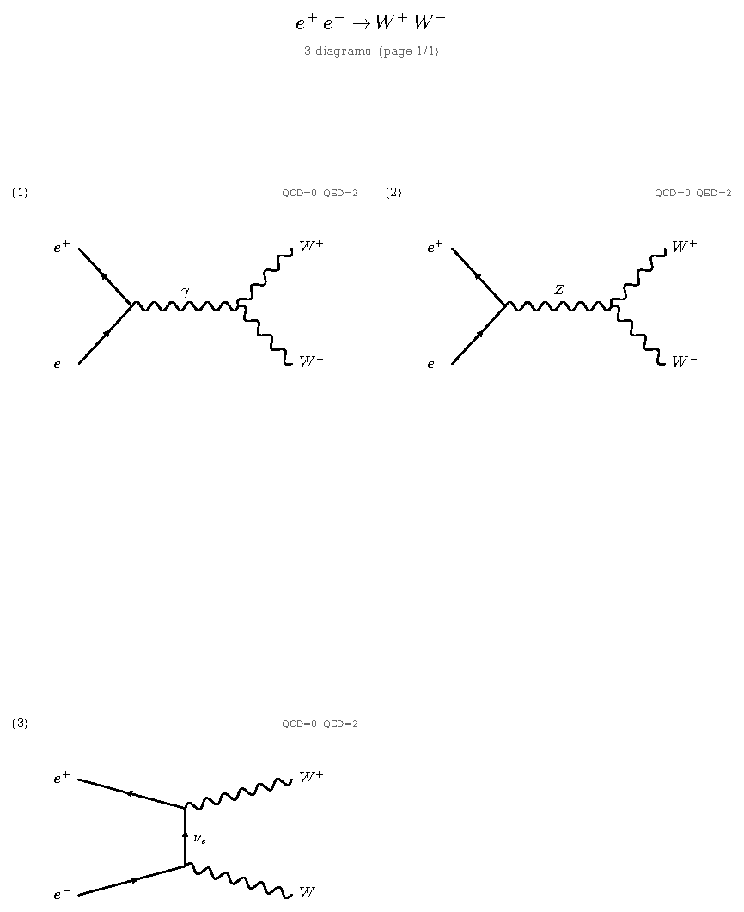
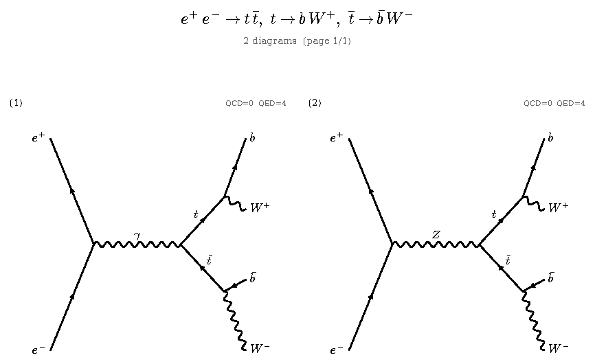

# pyfeyndiagram

Tree-level Standard Model Feynman diagram generator. Declare a process, get every diagram as a PDF and as TikZ-Feynman LaTeX.

Pure Python 3; depends only on `numpy` and `matplotlib` (no LaTeX needed to produce the PDF).

## Install

```
git clone https://github.com/amanmdesai/pyfeyndiagram.git   # private repo; needs GitHub auth
cd pyfeyndiagram
pip install .
```

Requires a recent pip and setuptools (>= 61); upgrade them if the install reports `UNKNOWN 0.0.0`.

Without installing: `python -m pyfeyndiagram ...` from the repository root.

## Usage

```
pyfeyndiagram "e+ e- > mu+ mu-" -o out
```

writes `out/ep_em_to_mup_mum.pdf` and `out/ep_em_to_mup_mum.tex` and prints the diagram count.

| Option | Meaning |
|---|---|
| `-o, --outdir DIR` | output directory (default `.`) |
| `-n, --name STEM` | output file stem (default derived from the process) |
| `--yukawa LIST` | fermions with a Higgs coupling (default `t,b,ta`) |
| `--ckm` | full CKM mixing instead of diagonal |
| `--max-qcd N`, `--max-qed N` | maximum power of `g_s` / `e` |
| `--no-pdf`, `--no-tex` | skip writing the PDF or the LaTeX file |
| `--list-particles` | print particle names, PDG ids and multiparticle labels, then exit |
| `--version` | print the version |

## Examples

Ready-made output (PDF, `.tex`) is in [`examples/`](examples/):

| Command | Diagrams | Files |
|---|---|---|
| `pyfeyndiagram "e+ e- > mu+ mu-" -n ee_to_mumu` | 2 | `ee_to_mumu.{pdf,tex}` |
| `pyfeyndiagram "e+ e- > w+ w-" -n ee_to_ww` | 3 | `ee_to_ww.{pdf,tex}` |
| `pyfeyndiagram "e+ e- > a a" -n ee_to_gammagamma` | 2 | `ee_to_gammagamma.{pdf,tex}` |
| `pyfeyndiagram "g g > t t~" -n gg_to_ttbar` | 3 | `gg_to_ttbar.{pdf,tex}` |
| `pyfeyndiagram "g g > g g" -n gg_to_gg` | 4 | `gg_to_gg.{pdf,tex}` |
| `pyfeyndiagram "h > b b~ g" -n h_to_bbg` | 2 | `h_to_bbg.{pdf,tex}` |
| `pyfeyndiagram "e+ e- > t t~, t > b w+, t~ > b~ w-" -n ee_to_ttbar_decay_chain` | 2 | `ee_to_ttbar_decay_chain.{pdf,tex}` |

All were generated with `-o examples`.

**Scattering**, `e+ e- > w+ w-` (the third diagram is the neutrino exchange):



**Production and decay in one diagram**, `e+ e- > t t~, t > b w+, t~ > b~ w-`:



**LaTeX output.** For `e+ e- > mu+ mu-` the first diagram is defined in `examples/ee_to_mumu.tex` as:

```latex
\expandafter\newcommand\csname feyndiagram1\endcsname{%
\begin{tikzpicture}
\begin{feynman}
\vertex (v0) at (2.70,0.00);
\vertex (v1) at (0.90,0.00);
\vertex (x0) at (0.00,0.98) {$e^{+}$};
\vertex (x1) at (0.00,-0.98) {$e^{-}$};
\vertex (x2) at (3.60,0.98) {$\mu^{+}$};
\vertex (x3) at (3.60,-0.98) {$\mu^{-}$};
\diagram* {
  (v1) -- [photon, edge label=\(\gamma\)] (v0),
  (x0) -- [anti fermion] (v1),
  (x1) -- [fermion] (v1),
  (v0) -- [anti fermion] (x2),
  (v0) -- [fermion] (x3)
};
\end{feynman}
\end{tikzpicture}%
}
```

and is used anywhere in the document with `\FeynDiagram{1}`.

### Process syntax (MadGraph-style)

```
e+ e- > w+ w-                       scattering
h > b b~ g                          decay (one incoming particle)
e+ e- > e+ e- a / z                 exclude Z from internal lines
u u~ > e+ e- g QCD=1                cap the QCD coupling order
p p > w+, w+ > l+ vl                multiparticle labels expand into subprocesses
e+ e- > t t~, t > b w+, t~ > b~ w-  production + decay in one diagram
e+ e- > t t~, (t > b w+, w+ > e+ ve), t~ > b~ w-
```

Names: `e- e+ mu- mu+ ta- ta+ ve vm vt` (antiparticles `ve~` ...), `u d c s b t` (`u~` ...), `a z w+ w- g h`.
Multiparticles: `j`/`p` = `g u d c s` and antiquarks (no `b`), `l+`, `l-`, `vl`, `vl~`.

Semantics:

- `QCD=n` / `QED=n` (also `<=`) are **maxima**. Electroweak and Higgs couplings all count as QED.
- A decay statement applies to every matching final-state particle. A decay chain keeps only diagrams where the decaying particle is an internal line; non-resonant diagrams are dropped (use the plain full process to get them).
- Only 1 or 2 incoming particles are supported. Kinematics and thresholds are ignored.

### Python API

```python
from pyfeyndiagram import generate_all, write_pdf, tex_document

results = generate_all("e+ e- > mu+ mu-")      # [(Process, [Diagram, ...]), ...]
write_pdf(results, "ee_mumu.pdf")
with open("ee_mumu.tex", "w") as f:
    f.write(tex_document(results))
```

## Output

- **PDF**: diagrams on A4 pages, with the coupling orders shown per diagram. Fermion arrows follow fermion flow; identical final-state particles are drawn with crossed lines where the topology requires it.
- **TeX**: a full document for `pdflatex` using the `tikz-feynman` package, with explicit vertex coordinates (no LuaLaTeX needed). Each diagram is also a macro `\FeynDiagram{n}`; copy the preamble and the definitions into your own document to use it. Numbering runs across all subprocesses.

## Model

Unitary gauge, so there are no Goldstone or ghost diagrams. Vertices: QED, QCD (including `ggg`, `gggg`), `Z` and `W` couplings, triple and quartic electroweak gauge couplings, `HVV`, `HHVV`, `HHH`, `HHHH`, and `Hff` for the `--yukawa` set. There are no tree-level `Hgg` or `Hγγ` vertices. Defaults (third-generation Yukawas, diagonal CKM) match MadGraph's `sm`.

## Limitations

- **Tree level only.** All-order generation is infinite and needs loop machinery.
- The generated `.tex` has **not been compiled**: no LaTeX was available during development. It was only checked structurally (balanced braces and environments, valid tikz-feynman edge styles). Please report compile errors.
- Layout is a deterministic barycentric embedding; large final states can look crowded.

## Checked diagram counts

| Process | Diagrams |
|---|---|
| `e+ e- > a a` | 2 |
| `e+ e- > e+ e-` | 4 (2 with `/ z`) |
| `e+ e- > w+ w-` | 3 |
| `g g > g g` | 4 |
| `g g > g g g` | 25 |
| `e+ e- > e+ e- a / z` | 8 |
| `g g > h` | 0 |
| `e+ e- > t t~, t > b w+, t~ > b~ w-` | 2 |
